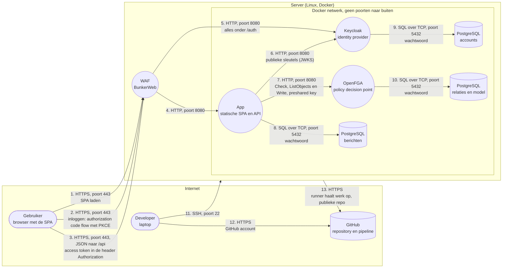

# Threat model

Dit model vertrok van de starter app en is per opdracht aangevuld. Het beschrijft de app na opdracht 4: achter een WAF, met inloggen via Keycloak (identity provider) en autorisatie via OpenFGA (policy decision point). Het volledige STRIDE-model per element zit als draw.io-diagram bij het verslag.

## Architectuur

Vertrouwensgrenzen: tussen de browser en de server, tussen het internet en de server, tussen de WAF en het Docker netwerk, en binnen dat netwerk tussen de API en de diensten waarop ze vertrouwt (Keycloak voor wie je bent, OpenFGA voor wat je mag). Let op: de SPA draait in de browser van de gebruiker. Alles wat de SPA controleert, kan een aanvaller omzeilen. Enkel wat de API controleert, telt.

Wie beslist wat: de API is het policy enforcement point. Ze controleert het access token (handtekening met RS256, issuer, audience, geldigheid) en leest de gebruiker uit de claim `preferred_username`. Of die gebruiker een bericht mag lezen of verwijderen, vraagt ze bij elke aanvraag aan OpenFGA. De regels staan op één plaats, in `openfga/model.json`: de ontvanger mag lezen, de afzender mag verwijderen.

## Dreigingen

Formulering: een A doet B op C door D, wat leidt tot E.

| # | STRIDE | Dreiging | Maatregel | Opdracht |
|---|---|---|---|---|
| 1 | Spoofing | Een gebruiker zet de naam van iemand anders in de header X-User, door het ontbreken van authenticatie, wat leidt tot het lezen van andermans berichten | Opgelost: inloggen via Keycloak, de API aanvaardt enkel een geldig access token en leest de gebruiker daaruit; X-User bestaat niet meer | 4 |
| 2 | Information disclosure | Een aanvaller luistert het verkeer af op flow 1, 2 en 3, door het gebruik van HTTP, wat leidt tot het lekken van berichten | HTTPS | 2 |
| 3 | Information disclosure | Een beheerder of aanvaller met toegang tot de databank leest alle berichten, doordat ze onversleuteld bewaard worden, wat leidt tot verlies van vertrouwelijkheid | End to end encryptie | 3 |
| 4 | Elevation of privilege | Een gebruiker vraagt een bericht op met het id van iemand anders, door het ontbreken van autorisatie, wat leidt tot het lezen of verwijderen van andermans berichten | Opgelost: OpenFGA beslist per bericht, ook voor de inbox, het zoeken en de export; niet toegestaan geeft 404 | 4 |
| 5 | Information disclosure | Iemand met toegang tot de repository leest het databankwachtwoord, doordat het in de configuratie staat, wat leidt tot volledige toegang tot de databank | Geheimen in een secrets manager | 6 |
| 6 | Tampering | Een aanvaller stuurt kwaadaardige invoer via een invoerveld, door onvoldoende validatie of encoding, wat leidt tot het uitvoeren van code of queries | Secure coding, SAST en een WAF | 2 |
| 7 | Tampering | Een aanvaller verstopt kwaadaardige code in een bibliotheek die de app gebruikt, door het ontbreken van controle op afhankelijkheden, wat leidt tot overname van de app | SCA in de pipeline | 2 |
| 8 | Spoofing | Een aanvaller raadt het rootwachtwoord van de server via flow 11, door aanmelden met wachtwoord, wat leidt tot overname van de server | SSH sleutels, fail2ban | 2 |
| 9 | Denial of service | Een aanvaller overspoelt de app met requests, door het ontbreken van rate limiting, wat leidt tot onbeschikbaarheid | Rate limiting in de WAF | 2 |
| 10 | Repudiation | Een gebruiker ontkent dat hij een bericht stuurde, doordat de afzender niet bewezen wordt en er geen logging is, wat leidt tot discussie zonder bewijs | Authenticatie, handtekeningen en logging | 3 en 4 |
| 11 | Spoofing | Een aanvaller steelt het access token uit de browser, door een XSS-fout in de SPA, wat leidt tot handelen in naam van het slachtoffer zolang het token geldig is | Token enkel in het geheugen en 5 minuten geldig; de XSS-fout verhelpen en een CSP blijven nodig | 4, rest later |
| 12 | Spoofing | Een aanvaller onderschept de inlogcode op flow 2, door een foute redirect, wat leidt tot een token op naam van het slachtoffer | PKCE (S256) verplicht, exacte redirect-URI, controle van state | 4 |
| 13 | Elevation of privilege | Een nieuwe gebruiker krijgt de naam van een vroegere gebruiker, doordat de API de gebruikersnaam als identiteit gebruikt, wat leidt tot toegang tot diens berichten | Gebruikersnaam niet wijzigbaar, geen zelfregistratie, namen niet hergebruiken | 4 |
| 14 | Elevation of privilege | Een aanvaller logt in op de beheerconsole van Keycloak via flow 5, doordat ze publiek bereikbaar is zonder tweede factor, wat leidt tot tokens voor elke gebruiker | Sterk wachtwoord buiten de repository; afschermen en een tweede factor: restrisico | later |
| 15 | Spoofing | Een aanvaller op het Docker netwerk levert valse sleutels aan op flow 6, doordat het interne verkeer geen TLS gebruikt, wat leidt tot zelf ondertekende tokens die de API aanvaardt | Docker netwerk zonder poorten naar buiten; TLS binnen het netwerk: restrisico | later |
| 16 | Tampering | Een aanvaller op het Docker netwerk voegt een relatie toe in OpenFGA via flow 7 of 10, door een gelekte preshared key of toegang tot de databank, wat leidt tot het lezen of verwijderen van andermans berichten | OpenFGA zonder poort naar buiten, key en wachtwoord buiten de repository, enkel de API schrijft relaties | 4 |
| 17 | Tampering | Een developer verruimt het autorisatiemodel, door een wijziging aan `openfga/model.json`, wat leidt tot te ruime toegang voor iedereen | Model in de repository: pull request, review en gedragstests in de pipeline | 4 |
| 18 | Elevation of privilege | Een developer voegt een API-route toe die OpenFGA niet raadpleegt, door een vergetelheid, wat leidt tot een omweg rond de autorisatie | Alle routes in één groep die een token eist; gedragstests in de pipeline | 4 |
| 19 | Denial of service | Een storing of aanvaller legt OpenFGA plat, doordat elke aanvraag ervan afhangt, wat leidt tot een app die geen berichten meer toont | Bewust: zonder antwoord weigert de API (503); healthcheck en automatische herstart | 4 |
| 20 | Information disclosure | Een beheerder leest de relaties in de databank van OpenFGA, doordat ze onversleuteld bewaard worden, wat leidt tot zicht op wie met wie communiceert | Beperkte toegang tot de databank; de metadata blijft zichtbaar: restrisico | later |
